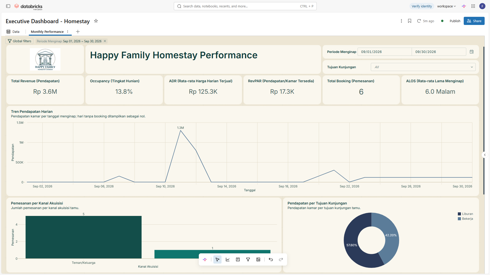
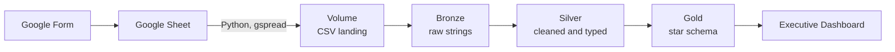
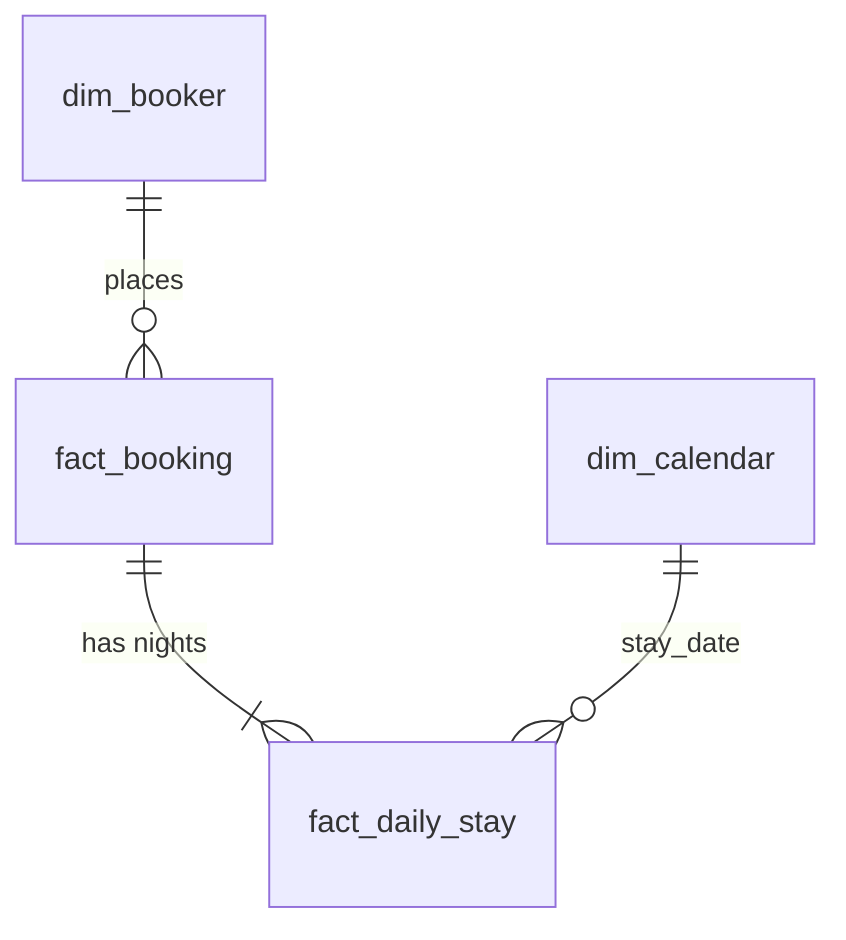

# Happy Family Homestay: End-to-End Data Pipeline & Executive Performance Dashboard

[](https://www.python.org/)
[](https://databricks.com/)
[](https://spark.apache.org/)
[](https://delta.io/)
[](https://en.wikipedia.org/wiki/SQL)
[](https://developers.google.com/sheets/api)

A Databricks data pipeline that turns booking form responses from a family-run homestay into a clean star schema and an executive dashboard for KPI reporting: occupancy, ADR, RevPAR, length of stay, and channel attribution.

> **Ringkasan (Bahasa Indonesia):** Proyek ini mengubah respons formulir pemesanan Happy Family Homestay, sebuah homestay keluarga yang sebelumnya tidak memiliki data, menjadi alur data otomatis di Databricks (Bronze, Silver, Gold) dan dasbor eksekutif berisi Occupancy, ADR, RevPAR, dan ALOS. Pada September 2026, pendapatan mencapai Rp 3,63 juta dengan Occupancy 13,81%, dan 5 dari 6 pemesanan berasal dari rekomendasi teman atau keluarga.

## Key Results (September 2026)

Six bookings in the reporting month, so read these as early signals, not conclusions.

| Metric | September 2026 | Note |
|--------|----------------|------|
| Revenue | Rp 3.63 million | 6 bookings |
| Occupancy Rate | 13.81% | 29 of 210 room-nights sold |
| ADR | about Rp 125,300 | per room-night sold |
| RevPAR | about Rp 17,300 | per room-night available |
| ALOS | 6 nights | median is 1 night; one 30-night stay pulls the average up |

- **Demand is concentrated.** Two holiday group trips on 11 and 12 September produced 58% of the month's revenue, at about Rp 233,000 per room-night sold versus about Rp 150,000 for short work stays.
- **Word of mouth drives bookings.** 5 of 6 bookings came from friends and family. The single TikTok booking was the largest group (16 guests, 5 rooms).
- **One long stay dominates room-nights.** A 30-night work stay, counted only for its September nights, made up 55% of the room-nights sold, at about Rp 58,000 per room-night, roughly a quarter of the holiday rate.
- **Occupancy and RevPAR assume a capacity of 7 room equivalents.** See [Business Metrics](#business-metrics).

## Dashboard Preview



*Executive dashboard in Databricks, built on the Gold tables.*

## Business Problem

**Happy Family Homestay** had no digital record-keeping. Bookings, guest details, and payments lived in paper notes, phone calls, and WhatsApp messages. That meant:

- No central data on check-ins, guest sources, or room availability.
- No visibility into occupancy, average daily rate, or revenue per available room.
- Manual, error-prone monthly tax reporting.
- Weak marketing decisions because guest-source data was incomplete.

**Business question:** which guests and channels drive revenue, and how can the homestay fill more rooms?

**Objective:** capture reservations through a standard form, transform the raw data into clean relational tables, model a star schema, and deliver executive KPI dashboards.

## Architecture

The pipeline follows a Medallion Architecture on Databricks with Delta Lake and Unity Catalog.



| Layer | Notebook | What it does | Output |
|-------|----------|--------------|--------|
| Landing | `00_gsheet_ingestion.py` | Reads the Google Sheet and writes a CSV file | `homestay_landing` Volume |
| Bronze | `01_bronze_load.sql` | Loads the CSV as raw strings, upserts with `MERGE` | `bronze.homestay` |
| Silver | `02_silver_cleaning.sql` | Parses dates and room text, calculates revenue | `silver.homestay_clean` |
| Gold | `03_gold_star_schema.sql` | Builds dimensions and facts, checks key uniqueness | `gold.*` |
| BI | Databricks dashboard | Executive KPI dashboard on the Gold tables | Dashboard |
| Orchestration | Databricks Workflows | Runs the four notebooks in order and sends email alerts | Raw CSV file and all tables refreshed daily at 01:00 (UTC+07:00, Asia/Jakarta) |

## Pipeline Walkthrough

### 1. Landing: `00_gsheet_ingestion.py`
- Reads the booking form responses from Google Sheets with a service account whose credentials are stored in a Databricks secret scope.
- Falls back to `data/sample_bookings.csv` in the Git folder when credentials are not available, so the pipeline runs without access to the real sheet.
- Writes the result as a CSV file into a Unity Catalog Volume.

### 2. Bronze: `01_bronze_load.sql`
- Reads the CSV with `read_files` and `inferSchema` off, so every column stays a raw string.
- Renames the form headers to `snake_case` column names.
- Upserts with `MERGE` on timestamp, name, and phone number, so re-runs do not create duplicates.

### 3. Silver: `02_silver_cleaning.sql`
- Parses timestamps and dates in two formats (`M/d/yyyy` and `yyyy-MM-dd`) with `try_to_timestamp` and `try_to_date`.
- Trims and lowercases guest name, email, and city.
- Splits room text such as `1 Kamar, 2 Rumah` into `kamar_count`, `rumah_count`, and `paviliun_count` with `REGEXP_EXTRACT`.
- Calculates stay nights, room equivalents (rumah = 5, paviliun = 2, kamar = 1), and standard revenue from nightly rates in Indonesian rupiah (IDR): kamar 200,000, rumah 1,300,000, paviliun 400,000.
- Uses the manual total from the form when it is filled in, otherwise the standard total.
- Creates a deterministic booking id (`BK-` plus a short hash of `created_at` and `guest_name`) and drops rows without a valid check-in date.
- Upserts with `MERGE` on the booking id.

### 4. Gold: `03_gold_star_schema.sql`
- Builds the four star-schema objects described below.
- Ends with a key check that returns rows only if a primary key is duplicated.

## Data Model



| Object | Grain | Primary key |
|--------|-------|-------------|
| `gold.dim_booker` | One row per unique booker (name, phone, email) | `booker_id` |
| `gold.dim_calendar` (view) | One row per calendar date, so zero-occupancy days are kept | `date` |
| `gold.fact_booking` | One row per booking | `booking_id` |
| `gold.fact_daily_stay` | One row per booking per stay night | `daily_stay_id` |

In Gold, personal details (name, phone, email) live only in `dim_booker`. The fact tables hold none. See [Data & Privacy](#data--privacy) for Bronze and Silver.

## Key Design Decisions

- **Raw Bronze, typed Silver:** Bronze keeps every value as a string, so a bad value can never break ingestion. Casting and cleaning happen in Silver.
- **Idempotent loads:** Bronze and Silver use `MERGE`, so a re-run updates existing rows instead of duplicating them.
- **Stable keys in Gold:** keys are built from the data (a hash of the booker's natural key, and booking id plus stay date) instead of `ROW_NUMBER()`. The same input always gives the same key, even after the Gold tables are rebuilt or new bookings arrive.
- **No secrets in the repo:** credentials live in a Databricks secret scope.
- **Runs without credentials:** the sample-data fallback lets anyone reproduce the pipeline end to end.
- **Built-in key check:** the last Gold cell verifies that every primary key is unique.

## Business Metrics

A **room-night** is one room rented for one night. Rooms are counted as room equivalents: one rumah is 5, one paviliun is 2, and one kamar is 1.

| Metric | Definition | Strategic value |
|--------|------------|-----------------|
| Occupancy Rate | Room-nights sold divided by room-nights available | Measures capacity utilization |
| Average Daily Rate (ADR) | Room revenue divided by room-nights sold | Indicates pricing effectiveness |
| RevPAR | Room revenue divided by room-nights available (equals ADR x occupancy) | Measures overall property efficiency |
| Average Length of Stay (ALOS) | Total stay nights divided by total bookings. One long stay can skew the average, so report the median alongside it | Helps plan housekeeping and minimum-stay decisions |
| Channel Attribution | Booking count by acquisition source | Identifies highest-converting channels |
| Tax & Compliance | Monthly revenue and room-night summaries | Speeds up audit and tax reporting |

**How they are calculated from Gold**
- Room-nights sold: `SUM(total_rooms_booked)` on `fact_daily_stay` for the period.
- Room revenue: `SUM(daily_revenue)` on `fact_daily_stay`. A booking's revenue is spread evenly over its nights, so a stay that crosses a month boundary is split correctly between the two months.
- Room-nights available: room capacity multiplied by the calendar days in the period.

**Available room capacity.** The booking form does not record how many rooms the homestay has, so capacity is a fixed input of 7 room equivalents: one rumah (5 rooms) plus one paviliun (2 rooms). That gives 210 room-nights for September 2026 (30 nights x 7). The value is written into the `occupancy` and `revpar` measures of the dashboard's `kpi_daily_homestay` dataset, so change it there if the number of units changes.

## Repository Structure

```
happy-family-homestay-analytics/
├── README.md
├── assets/                      # architecture diagram and dashboard screenshots
│   ├── architecture.png
│   └── dashboard_preview.png
├── dashboard/
│   └── homestay_dashboard.lvdash.json   # exported dashboard, import it in Databricks
├── notebooks/
│   ├── 00_gsheet_ingestion.py   # Google Sheet -> CSV in a Volume
│   ├── 01_bronze_load.sql       # CSV -> bronze.homestay
│   ├── 02_silver_cleaning.sql   # bronze -> silver.homestay_clean
│   └── 03_gold_star_schema.sql  # silver -> gold star schema and key check
└── data/
    └── sample_bookings.csv      # sample data used when no credentials are set
```

## How to Run

**Requirements:** a Databricks workspace with Unity Catalog and permission to create a catalog and a volume. Tested on Databricks Free Edition.

1. **Add the repo as a Git folder:** in your workspace, create a Git folder from `https://github.com/farisyabai/happy-family-homestay-analytics`.
2. **(Optional) Connect the live Google Sheet:**
   - Create a secret scope `gcp_credentials` with a secret `service_acc_json` that contains your service account JSON.
   - Share the Google Sheet with the service account's email address.
   - Skip this step to run on `data/sample_bookings.csv` instead.
3. **Run the notebooks in order:** `00_gsheet_ingestion.py`, `01_bronze_load.sql`, `02_silver_cleaning.sql`, `03_gold_star_schema.sql`.
4. **Check the keys:** the last cell of `03_gold_star_schema.sql` should return no rows.
5. **(Optional) Schedule it:** create a Databricks Workflow with the four notebooks as tasks in the order above, and add an email notification.
6. **Open the dashboard:** the executive dashboard is a Databricks AI/BI dashboard. Its labels are in Bahasa Indonesia.
   - Make sure steps 3 and 4 have run, so the Gold tables exist.
   - In the workspace sidebar, open **Dashboards** and import `dashboard/homestay_dashboard.lvdash.json`.
   - Select a SQL warehouse. The datasets already point to `happy_family_homestay`.
   - Publish the dashboard to view it.
   - Filters: stay period (date range) and visiting purpose.
   - Data sources:
     - `kpi_daily_homestay` dataset (`dim_calendar`, `fact_daily_stay`, `fact_booking`): Occupancy, ADR, RevPAR, total revenue, daily revenue trend, and revenue by visiting purpose.
     - `fact_booking`: ALOS and total bookings.
     - `fact_daily_stay`: the daily stay table.

## Data & Privacy

- **Gold:** names, phone numbers, and emails appear only in `dim_booker`. The fact tables hold none.
- **Bronze and Silver:** these layers keep the personal details from the form, because they are the raw and cleaned copies of the source. In a real deployment, restrict access to these schemas.
- **Sample data:** `data/sample_bookings.csv` is sample data in which real customer personal details were replaced with fake values.
- **Credentials:** never committed to the repository. They live in a Databricks secret scope.

## Contact

- Author: Faris Riski
- LinkedIn: [farisriski86](https://www.linkedin.com/in/farisriski86/)
- Email: farisriski86@gmail.com
